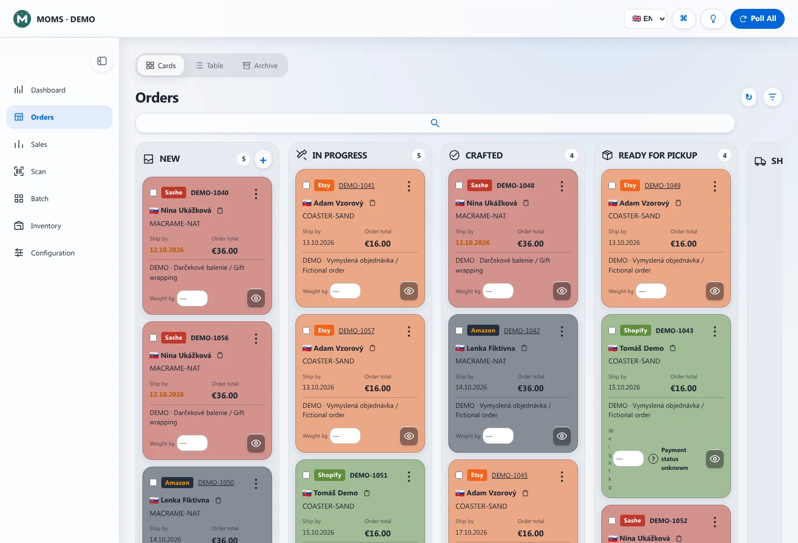
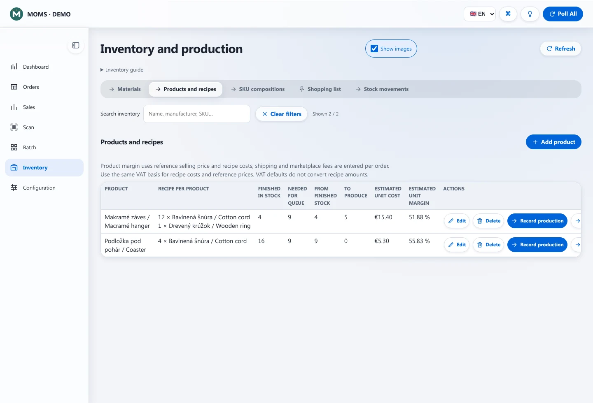
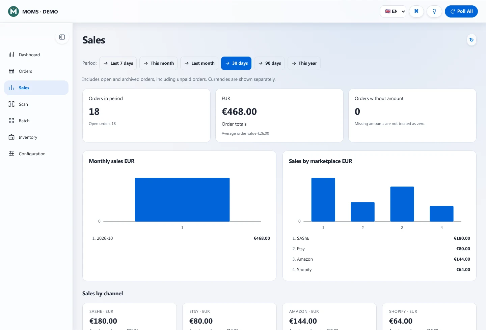
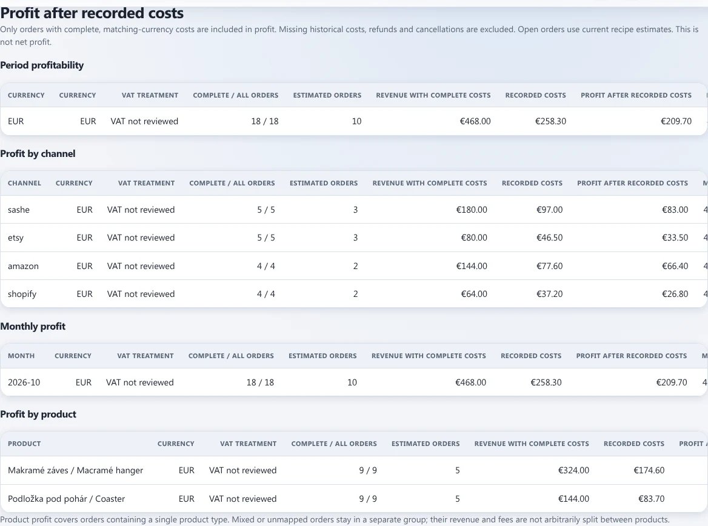

# MOMS — Multichannel Order Management System

Created and maintained by **Miroslav Bakoš** · [miroslav@miroslavbakos.com](mailto:miroslav@miroslavbakos.com)

MOMS is a free, self-hosted application for makers, artists, sole traders and small workshops. Manage orders, production, stock, recorded costs and dispatch on your own computer. The interface supports Slovak and English.

**Free software under GPLv3:** no subscription, activation key, trial expiry, paid feature tiers or licence-based order limits. You can use, study, modify and redistribute it under the [GNU GPL version 3](LICENSE). External marketplaces and optional services have their own access requirements, fees and rate limits; normal security and resource safeguards still apply.

## Features

MOMS brings the everyday workflow from incoming order to production and dispatch into one local application:

- **Multichannel orders:** synchronize orders from SAShE, Etsy, Amazon and Shopify, or create orders manually. Review customer delivery details, items, quantities, notes and deadlines; filter orders and work in board, table or archive views.
- **Stock and inventory:** track materials and finished products, record stock receipts and movements, and see what is available, allocated to orders or missing. Plan purchases using material requirements and the shopping list.
- **Product recipes:** define the materials and quantities needed to make each product, add labour and packaging costs, and map marketplace SKUs to products or product combinations. See how many finished pieces can be used and how many still need production.
- **Production planning:** organize orders in configurable workflow stages and review requirements by order. Marking production complete consumes stock once; reopening restores the recorded stock snapshot.
- **Shipping labels — Slovenská pošta:** create postal shipment labels through the integration API using your own credentials and sender details, with configurable parcel/service and customs information.
- **Shipping labels — GLS Slovakia:** create labels through MyGLS using your own GLS account, client number, sender/pickup details and parcel settings. Carrier access and service availability depend on your account.
- **Shipment records and tracking:** keep shipment tracking numbers and labels with the order and review supported carrier tracking statuses. Creating a carrier label and confirming dispatch to a marketplace are separate actions.
- **Mark as Shipped:** supported Etsy, Amazon and Shopify orders ask for confirmation before sending saved tracking to the marketplace. “Mark as Shipped (archive)” archives only after successful marketplace confirmation; rejected or unclear results remain available for review. Manual orders archive directly; SAShE has no dispatch writeback. Individual and selected-order actions are supported, subject to each order's eligibility.
- **Marketplace dispatch confirmation:** send full-order tracking to Etsy, confirm an eligible merchant-fulfilled Amazon shipment, or create a Shopify fulfillment. Check remote tracking after an uncertain result instead of automatically sending another shipment.
- **Sales and recorded costs:** compare sales by period and channel; record production, shipping, marketplace, payment and other costs, and review contribution by channel, month and product. Configure VAT registration and rates, including non-payer treatment. Missing costs and mixed currencies are identified rather than treated as reliable profit.
- **Accounting handoff:** export order revenue and recorded costs as CSV for your accountant. This is an operational export, not a tax ledger.
- **Backups and diagnostics:** create and verify full backups, restore an installation, optionally copy backups to a mounted external destination, and review synchronization/backup health.
- **Local use:** keep data in your own PostgreSQL database, with encrypted secret settings, English/Slovak interface and phone access over a private LAN. Public HTTPS callbacks are configured separately when an OAuth connection needs them.

## Supported APIs and actions

| Integration | Read/import actions | Write actions | Requirements and limits |
| --- | --- | --- | --- |
| **SAShE seller API** | Orders/packages and their line items and delivery details | No marketplace dispatch writeback | Seller user ID and API key; no OAuth callback |
| **Etsy Open API v3** | Orders/receipts, items, delivery details and existing shipment tracking | Send full-order shipment tracking and buyer shipping notification | Own approved application and OAuth; `transactions_r` for orders, `transactions_w` and endpoint approval for shipment confirmation |
| **Amazon Selling Partner API** | Orders and items, permitted delivery data, remote packages; Finances balances; review-request eligibility | Confirm a merchant-fulfilled shipment; request product review/seller feedback when Amazon permits it | Own SP-API application, seller authorization and relevant roles; address access is separately restricted; no FBA shipment automation |
| **Shopify Admin API** | Orders and items, delivery/payment/fulfillment status, fulfillment orders; Shopify Payments balances when permitted | Create a full-order merchant-managed fulfillment with tracking and customer notification | Store token, own-store client credentials or OAuth; order/fulfillment scopes and additional balance access where applicable |
| **GLS Slovakia / MyGLS** | Label results and supported tracking information | Create shipping labels with configured sender/account details | MyGLS account and API credentials |
| **Slovenská pošta integration API** | Label results; supported postal tracking | Create postal shipment labels | Own API credentials, sender, service and customs configuration |

Marketplace shipment writes require one complete eligible order with original item identifiers and matching quantities. Partial marketplace shipment writeback, marketplace refunds/cancellations and listing/catalog management are not supported here. After an unclear write result, reconciliation reads remote tracking instead of blindly sending again. Balance views use provider-reported funds, keep currencies separate and show unavailable data when access is missing; Etsy/SAShE balances are not supported.

See [installation and configuration](docs/INSTALLATION.md), [marketplace connection and callback guide](docs/MARKETPLACE-CONNECTIONS.md), and [seller workflows and dispatch permissions](docs/SELLER-OPERATIONS.md).

Screenshots and project overview: [moms.miroslavbakos.com](https://moms.miroslavbakos.com/). Website screenshots contain fictional demo data.

## Screenshots (English interface)

These screenshots show the real MOMS interface with synthetic demo orders from SAShE, Etsy, Amazon and Shopify. All customer names, addresses, order references, products and amounts are fictional. Demo data is not seeded into a fresh installation; sample names and product labels include Slovak and English text.

### Orders and production board

Follow orders across production stages, with marketplace badges, deadlines and order totals.



### Inventory and product recipes

See finished stock, recipe materials and quantities still needed for production.



### Sales overview

Compare order totals by period and marketplace, with currencies kept separate.



### Profit after recorded costs

Review recorded costs and contribution by channel, month and product. This view is not net profit or a tax ledger.



## Quick start with Docker

Install Docker Engine/Desktop with Compose, then in this repository:

```sh
cp .env.example .env
```

Edit `.env`: set a unique `APP_SECRET` (at least 32 random characters), `APP_BASIC_AUTH_USER` and `APP_BASIC_AUTH_PASSWORD`. Generate a secret with a password manager or `openssl rand -hex 32`. Keep marketplace integrations disabled until you configure your own accounts.

```sh
docker compose up -d --build
```

Open **http://localhost:3080**. For another device on your private Wi-Fi, use `http://YOUR-COMPUTER-LAN-IP:3080`. Set `MOMS_LAN_ADDRESS` to that computer's LAN address if the phone connection QR needs it. The computer must remain running for synchronization. Do not expose the application port directly to the public Internet.

The provided database credentials are local development defaults inside the Docker network; choose your own matching database credentials and `DATABASE_URL` if adapting the deployment. PostgreSQL is not published on a host port.

## Connect your shops

Configure your own credentials in application settings. Secret fields are stored encrypted and are not returned to the browser. Changed settings may require an application restart.

- **SAShE:** seller ID and API key; no OAuth callback required.
- **Etsy:** your own application and OAuth permissions. Use the setup guide for the callback URL. Marketplace approval determines available access.
- **Amazon:** a private SP-API application can use its own refresh token. Third-party authorization requires registered callback URLs and the appropriate roles.
- **Shopify:** supported own-store credentials or OAuth; use the setup guide and the access scopes required by your shop.

Use the [callback setup guide](docs/MARKETPLACE-CONNECTIONS.md#tailscale-funnel-for-oauth-callbacks) if public HTTPS is needed. Tailscale is optional and subject to its own terms. Publishing the whole application through a public tunnel is not necessary for a callback-only setup.

## Data, updates and backups

Docker keeps the database in a named volume and mounts `settings/`, `labels/` and `backups/` from the host. Full backups contain credentials and customer data: keep them private. Preserve your bootstrap `.env` and encryption keys. Test restores on a separate installation.

After backing up, update your checkout and run `docker compose up -d --build`. Do not use `docker compose down -v` unless you intend to delete database volumes.

[Desktop installation](docs/DESKTOP.md) documents the native launcher and bundle tooling. Windows/macOS packaging still needs native acceptance testing; a source repository is not a promise of a tested installer for every platform.

## Development

Use Node.js 22 and PostgreSQL 16. Run `npm ci`, then `npm run verify` for offline checks. `sh scripts/verify-db.sh` runs isolated PostgreSQL checks using Docker without production data. See [development notes](docs/DEVELOPMENT.md). Browser checks use mocked APIs; never point mutation tests at a working shop.

## Support and contributions

MOMS is free. If you find it useful, you can support its development via PayPal.

[](https://www.paypal.com/donate/?business=7TG8WFWH5K79Y&no_recurring=0&item_name=for+MOMS+development&currency_code=EUR)

Contributions are entirely optional, unlock no additional features and do not purchase support.

This is a spare-time project, provided as-is without warranty to the extent permitted by law. Support and updates depend on the maintainer's availability; response times, fixes and continued development are not guaranteed. A contribution does not purchase support.

Bug reports and pull requests are welcome. Remove credentials, customer information and private logs before sharing anything. Forks are welcome under GPLv3; maintaining a fork does not oblige the original maintainer to support it. See [CONTRIBUTING.md](CONTRIBUTING.md) and [SECURITY.md](SECURITY.md).

## Licence and attribution

Project code is licensed under **GPL-3.0-only**. Copyright © 2026 Miroslav Bakoš for copyrightable contributions. Third-party libraries and assets retain their respective licences and notices; see [NOTICE](NOTICE). No claim of authorship is made over third-party components.
